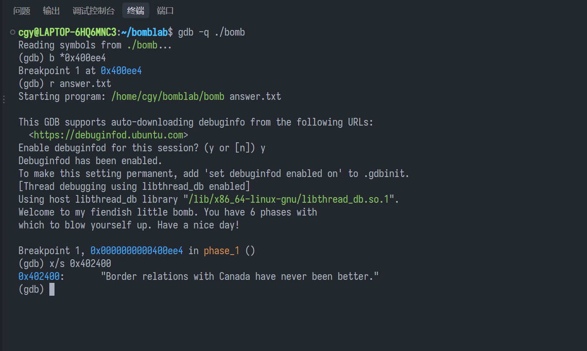
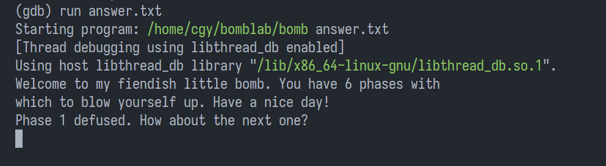
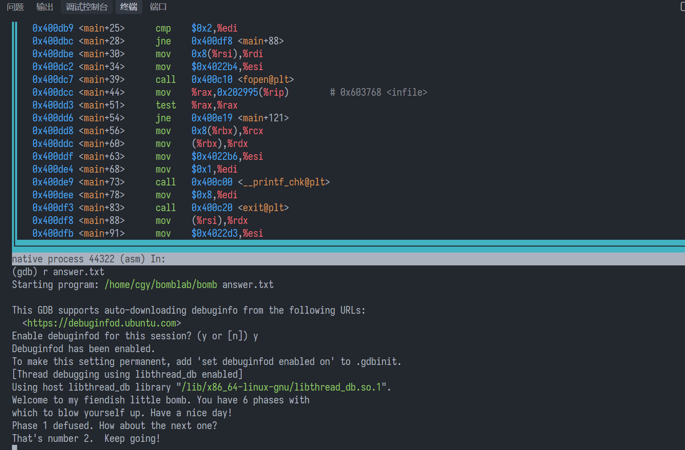
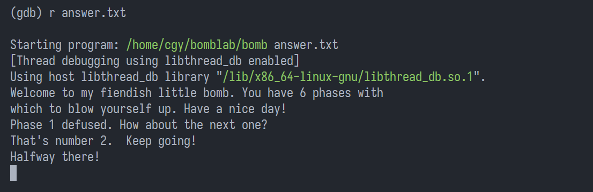
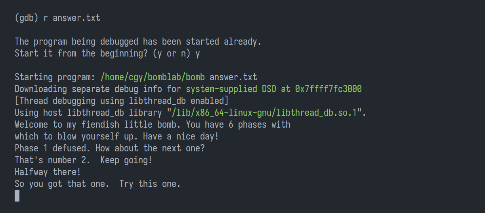
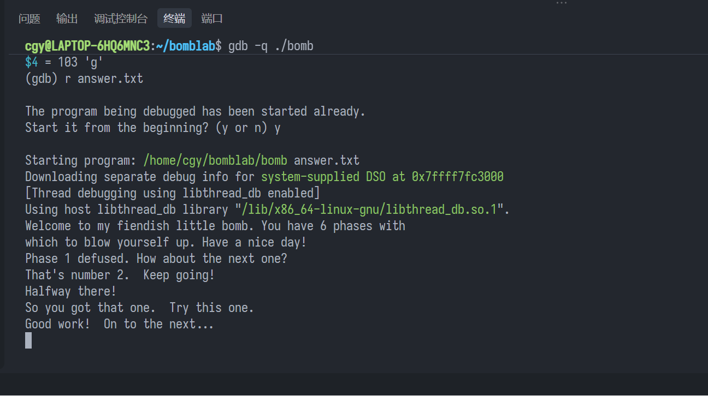
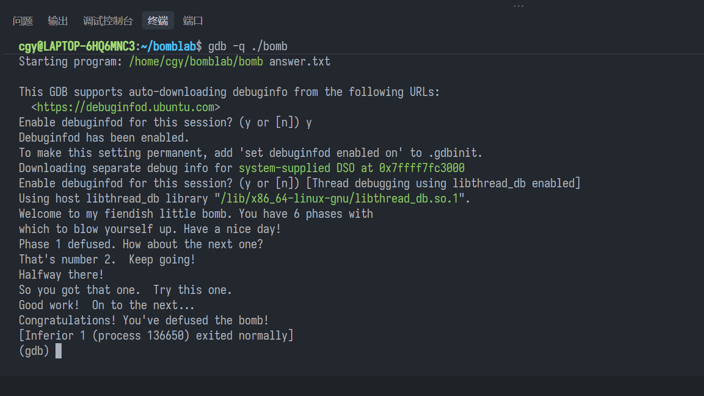

## Bomb Lab简要介绍

Bomb Lab 是 CS:APP 的第二个 Lab，对应教材第三章《程序的机器级表示》。该 Lab旨在加强同学们阅读汇编代码的能力，以及训练同学们使用GDB调试工具。Bomb Lab 大概是 CS:APP 配套实验里名气最大的一个，CMU 官方页面把它称为“ A legendary lab among the CMU undergrads”。
在 Bomb Lab 中，需要拆除6个对应的二进制炸弹(即 phase 1 ～ phase 6)，每个炸弹都有一个密码，通过输出正确的密码来拆除炸弹。如果输入了错误的指令，炸弹就会爆炸。这个实验还是十分有趣（cool）的。你会像一个侦探一样一步步抽丝剥茧，还要心惊胆战的避免炸弹爆炸。紧张感与成就感并存。这个实验难度中等。苯人在这个实验花费了大概7-8个小时。
整个 Lab的思路是，分析源码和二进制炸弹反汇编得出的汇编代码，并使用 `gdb` 工具进行调试以防止炸弹爆炸，从而得出正确答案。

## 在动手之前
你可以在 CMU 课程官网 [CS:APP Labs](https://csapp.cs.cmu.edu/3e/labs.html) 获取实验的代码。下载完源码后，我们会得到一个 `bomb.tar`，解压之后，会有三个文件：

```text
.
├── bomb
├── bomb.c
└── README

1 directory, 3 files
```

其中 `bomb` 就是我们要拆的炸弹，`bomb.c` 就是整个 `bomb` 的源代码，里面可以看到程序的骨架和输入输出顺序。

### GDB常用指令
下面是本实验常用的 GDB 指令：

| 简写 | 作用 | 示例 |
| :------------------: | :------------------------------------------ | :------------------ |
| `q` | 退出 GDB | `q` |
| `r` | 运行到断点或结束 | `r answer.txt` |
| `b 函数 ` | 在函数入口断点 | `b phase_6` |
| `b *地址 ` | 在地址处断点 | `b *0x401153` |
| `i b` | 列出所有断点 | `i b` |
| `d 编号 ` / `d` | 删指定断点 / 全删 | `d 1` |
| `si` / `ni` | 单步一条指令（进入 / 不进入 `call`） | `si` / `ni` |
| `c` | 继续到下一断点 | `c` |
| `fin` | 运行到当前函数返回 | `fin` |
| `j *地址 ` | 跳到该地址继续执行 | `j *(phase_1+0x1d)` |
| `disas` | 反汇编当前函数 | `disas` |
| `p` | 打印表达式的值：加 `/x` 十六进制、`/d` 十进制、`/t` 二进制 | `p $rax`、`p/x $rip` |
| `x` | 查看内存，写法为 `x/数量 格式 单位 地址 `（见下方说明） | `x/6wd $rsp` |
| `i r` | 所有寄存器值 | `i r` |
| `la asm` / `la regs` | 分屏看汇编 / 寄存器 | `la asm` |
| `comm 编号 ` | 给断点配自动命令（`end` 结束） | `comm 1` |
| `h` | 帮助 | `h b` |

`x` 的完整写法是 **`x/数量 格式 单位 地址 `**。以 `x/6wd $rsp` 为例：从 `$rsp` 开始，看 **6** 个、每个 **4 字节**（`w`）的数，用 **十进制**（`d`）显示。

| 写法 | 含义 |
| :---------------- | :------------------------------ |
| `x/6wd $rsp` | 6 个 4 字节数，十进制（常用来查看 `int a[6]`） |
| `x/gx $rbx` | 1 个 8 字节数，十六进制（常用来查看指针） |
| `x/3ag $rsp` | 3 个 8 字节的数，按地址形式显示 |
| `x/s 0x402400` | 从该地址读出一个字符串 |
| `x/16cb 0x4024b0` | 16 个字符（`c` 按字符显示） |
| `x/i $rip` | 把该地址处的机器码当指令反汇编 1 条 |

其中**单位**：`b` = 1 字节、`w` = 4 字节、`g` = 8 字节；**格式**：`d` 十进制、`x` 十六进制、`s` 字符串、`c` 字符、`i` 指令、`a` 地址。

## 开始动手！
我们先来阅读 `bomb.c` 的代码，可以看到如下结构：

```c
    /* Hmm...  Six phases must be more secure than one phase! */
    input = read_line();             /* Get input                   */
    phase_1(input);                  /* Run the phase               */
    phase_defused();                 /* Drat!  They figured it out!
                                      * Let me know how they did it. */
    printf("Phase 1 defused. How about the next one?\n");
```

这说明我们的输入 `input` 会作为传入的参数，如果 `input` 不正确炸弹就会爆炸。
我们可以运行 `objdump -d bomb > bomb.s` 命令，对炸弹进行反汇编得到汇编代码。
我们可以创建一个 `answer.txt`，里面每行存放我们每个 phase 的答案，写入一个phase答案时不要忘记换行，别问我是怎么知道的（

### Phase 1
我们先来阅读Phase 1的汇编代码：

```asm
0000000000400ee0 <phase_1>:
  400ee0:   48 83 ec 08         sub    $0x8,%rsp                   # 分配 8 字节栈空间
  400ee4:   be 00 24 40 00      mov    $0x402400,%esi              # esi = 标准答案地址
  400ee9:   e8 4a 04 00 00      call   401338 <strings_not_equal>  # 比较两字符串
  400eee:   85 c0               test   %eax,%eax                   # 检验返回值
  400ef0:   74 05               je     400ef7 <phase_1+0x17>       # 相等则跳过爆炸
  400ef2:   e8 43 05 00 00      call   40143a <explode_bomb>       # 不等则爆炸
  400ef7:   48 83 c4 08         add    $0x8,%rsp                   # 释放栈空间
  400efb:   c3                  ret                                # 返回
```

这份汇编代码很好懂：它比较两个字符串是否相等，相等则跳过 `explode_bomb`，不等则引爆炸弹。
因此我们可以在 `call <strings_not_equal>` 之前设置断点，得到 `0x402400` 处的字符串。

首先，打开 `answer.txt` 文件，随便输入一行：

```
Hello world
```

然后运行以下指令：

```
gdb -q ./bomb
b *400ee4
r answer.txt
x/s 0x402400
```



得到答案为：

`Border relations with Canada have never been better.`

我们把答案写入 `answer.txt`。
重新运行，得到以下输出，表示已经完成了 `phase 1`。



### Phase 2
先阅读 `Phase_2` 的源码：

```asm
0000000000400efc <phase_2>:
  400efc:   55                  push   %rbp                        # 保存调用者的 rbp
  400efd:   53                  push   %rbx                        # 保存调用者的 rbx
  400efe:   48 83 ec 28         sub    $0x28,%rsp                  # 分配 40 字节栈空间放 6 个 int
  400f02:   48 89 e6            mov    %rsp,%rsi                   # 第二个参数 = 数组起始地址
  400f05:   e8 52 05 00 00      call   40145c <read_six_numbers>   # 读入 6 个整数
  400f0a:   83 3c 24 01         cmpl   $0x1,(%rsp)                 # 比较 a[0] 与 1
  400f0e:   74 20               je     400f30 <phase_2+0x34>       # a[0]==1 → 进入循环
  400f10:   e8 25 05 00 00      call   40143a <explode_bomb>       # a[0]!=1 → 爆炸
  400f15:   eb 19               jmp    400f30 <phase_2+0x34>       # 跳过去（实际不会走到）
  400f17:   8b 43 fc            mov    -0x4(%rbx),%eax             # eax = a[i-1]
  400f1a:   01 c0               add    %eax,%eax                   # eax = 2 * a[i-1]
  400f1c:   39 03               cmp    %eax,(%rbx)                 # 比较 a[i] 与 2*a[i-1]
  400f1e:   74 05               je     400f25 <phase_2+0x29>       # 相等 → 继续下一个
  400f20:   e8 15 05 00 00      call   40143a <explode_bomb>       # 不相等 → 爆炸
  400f25:   48 83 c3 04         add    $0x4,%rbx                   # 指针后移一个 int
  400f29:   48 39 eb            cmp    %rbp,%rbx                   # 到达数组末尾了吗
  400f2c:   75 e9               jne    400f17 <phase_2+0x1b>       # 没到 → 继续循环
  400f2e:   eb 0c               jmp    400f3c <phase_2+0x40>       # 到了 → 跳到收尾
  400f30:   48 8d 5c 24 04      lea    0x4(%rsp),%rbx              # rbx = &a[1]
  400f35:   48 8d 6c 24 18      lea    0x18(%rsp),%rbp             # rbp = &a[6]（结束地址）
  400f3a:   eb db               jmp    400f17 <phase_2+0x1b>       # 进入循环
  400f3c:   48 83 c4 28         add    $0x28,%rsp                  # 释放栈空间
  400f40:   5b                  pop    %rbx                        # 恢复 rbx
  400f41:   5d                  pop    %rbp                        # 恢复 rbp
  400f42:   c3                  ret                                # 返回
```

我们看到了 `read_six_numbers` 这个函数，这告诉我们答案就是六个整数。
这段汇编代码用 C 语言可以表示为：

```c
void phase_2(char *input)
{
    int a[6];

    read_six_numbers(input, a);      // 读入 6 个整数

    if (a[0] != 1)                   // 第一个数必须是 1
        explode_bomb();

    for (int i = 1; i < 6; i++)      // 后面每个数都是前一个数的 2 倍
        if (a[i] != 2 * a[i - 1])
            explode_bomb();
}
```

那么答案已经很明显了：

`1 2 4 8 16 32`

我们可以阅读 `read_six_numbers` 函数的汇编代码：

```asm
000000000040145c <read_six_numbers>:
  40145c:   48 83 ec 18         sub    $0x18,%rsp                   # 分配 24 字节栈空间（放多出的两个参数）
  401460:   48 89 f2            mov    %rsi,%rdx                    # 第 3 个参数 = 数组首地址 a[0]
  401463:   48 8d 4e 04         lea    0x4(%rsi),%rcx               # 第 4 个参数 = &a[1]
  401467:   48 8d 46 14         lea    0x14(%rsi),%rax              # rax = &a[5]
  40146b:   48 89 44 24 08      mov    %rax,0x8(%rsp)               # 第 8 个参数 &a[5] 压栈
  401470:   48 8d 46 10         lea    0x10(%rsi),%rax              # rax = &a[4]
  401474:   48 89 04 24         mov    %rax,(%rsp)                  # 第 7 个参数 &a[4] 压栈
  401478:   4c 8d 4e 0c         lea    0xc(%rsi),%r9                # 第 5 个参数 = &a[3]
  40147c:   4c 8d 46 08         lea    0x8(%rsi),%r8                # 第 6 个参数 = &a[2]
  401480:   be c3 25 40 00      mov    $0x4025c3,%esi               # 第 2 个参数 = 格式串 "%d %d %d %d %d %d"
  401485:   b8 00 00 00 00      mov    $0x0,%eax                    # 可变参数函数要求 al = 0
  40148a:   e8 61 f7 ff ff      call   400bf0 <__isoc99_sscanf@plt> # 调用 sscanf 读入 6 个整数
  40148f:   83 f8 05            cmp    $0x5,%eax                    # 返回值（成功读入个数）与 5 比较
  401492:   7f 05               jg     401499 <read_six_numbers+0x3d> # 大于 5（即 6 个）→ 正常
  401494:   e8 a1 ff ff ff      call   40143a <explode_bomb>        # 不足 6 个 → 爆炸
  401499:   48 83 c4 18         add    $0x18,%rsp                   # 释放栈空间
  40149d:   c3                  ret                                 # 返回
```

我们可以用 `x/s 0x4025c3` 查看格式串的内容为 `%d %d %d %d %d %d`，也就是说函数的输入确实是 6 个整数。
我们可以看到参数个数超过 6 个，多出的被放在栈上。
现在我们把答案写到 `answer.txt` 中，可以看到:



说明我们已经完成了Phase 2。

### Phase 3
先阅读 `Phase_3` 的源码：

```asm
0000000000400f43 <phase_3>:
  400f43:   48 83 ec 18         sub    $0x18,%rsp                   # 分配栈空间
  400f47:   48 8d 4c 24 0c      lea    0xc(%rsp),%rcx               # 第 4 个参数 = &b（第二个整数）
  400f4c:   48 8d 54 24 08      lea    0x8(%rsp),%rdx               # 第 3 个参数 = &a（第一个整数）
  400f51:   be cf 25 40 00      mov    $0x4025cf,%esi               # 第 2 个参数 = 格式串 "%d %d"
  400f56:   b8 00 00 00 00      mov    $0x0,%eax                    # 可变参数函数要求 al = 0
  400f5b:   e8 90 fc ff ff      call   400bf0 <__isoc99_sscanf@plt>  # 读入两个整数
  400f60:   83 f8 01            cmp    $0x1,%eax                    # 返回值（读入个数）与 1 比较
  400f63:   7f 05               jg     400f6a <phase_3+0x27>        # 大于 1（读到 2 个）→ 继续
  400f65:   e8 d0 04 00 00      call   40143a <explode_bomb>        # 不足 2 个 → 爆炸
  400f6a:   83 7c 24 08 07      cmpl   $0x7,0x8(%rsp)               # 比较第一个数 a 与 7
  400f6f:   77 3c               ja     400fad <phase_3+0x6a>        # 无符号大于 7 → 爆炸
  400f71:   8b 44 24 08         mov    0x8(%rsp),%eax               # eax = a
  400f75:   ff 24 c5 70 24 40 00   jmp    *0x402470(,%rax,8)           # 跳转表：按 a 的值跳到对应分支
  400f7c:   b8 cf 00 00 00      mov    $0xcf,%eax                   # case 0：eax = 207
  400f81:   eb 3b               jmp    400fbe <phase_3+0x7b>        # 跳到比较
  400f83:   b8 c3 02 00 00      mov    $0x2c3,%eax                  # case 2：eax = 707
  400f88:   eb 34               jmp    400fbe <phase_3+0x7b>        # 跳到比较
  400f8a:   b8 00 01 00 00      mov    $0x100,%eax                  # case 3：eax = 256
  400f8f:   eb 2d               jmp    400fbe <phase_3+0x7b>        # 跳到比较
  400f91:   b8 85 01 00 00      mov    $0x185,%eax                  # case 4：eax = 389
  400f96:   eb 26               jmp    400fbe <phase_3+0x7b>        # 跳到比较
  400f98:   b8 ce 00 00 00      mov    $0xce,%eax                   # case 5：eax = 206
  400f9d:   eb 1f               jmp    400fbe <phase_3+0x7b>        # 跳到比较
  400f9f:   b8 aa 02 00 00      mov    $0x2aa,%eax                  # case 6：eax = 682
  400fa4:   eb 18               jmp    400fbe <phase_3+0x7b>        # 跳到比较
  400fa6:   b8 47 01 00 00      mov    $0x147,%eax                  # case 7：eax = 327
  400fab:   eb 11               jmp    400fbe <phase_3+0x7b>        # 跳到比较
  400fad:   e8 88 04 00 00      call   40143a <explode_bomb>        # a > 7 → 爆炸
  400fb2:   b8 00 00 00 00      mov    $0x0,%eax                    # （爆炸后走不到）
  400fb7:   eb 05               jmp    400fbe <phase_3+0x7b>        # 跳到比较
  400fb9:   b8 37 01 00 00      mov    $0x137,%eax                  # case 1：eax = 311
  400fbe:   3b 44 24 0c         cmp    0xc(%rsp),%eax               # 比较 b 与分支给出的值
  400fc2:   74 05               je     400fc9 <phase_3+0x86>        # 相等 → 通过
  400fc4:   e8 71 04 00 00      call   40143a <explode_bomb>        # 不相等 → 爆炸
  400fc9:   48 83 c4 18         add    $0x18,%rsp                   # 释放栈空间
  400fcd:   c3                  ret                                 # 返回
```

依照惯例我们先用 `x/s 0x4025cf` 查看格式串的内容为 `%d %d`，也就是说答案是 2 个整数。
我们看到如此之多的 `jmp` 指令，以及下面这两行关键代码：

```asm
  400f71:   8b 44 24 08         mov    0x8(%rsp),%eax               # eax = a
  400f75:   ff 24 c5 70 24 40 00   jmp    *0x402470(,%rax,8)           # 跳转表：按 a 的值跳到对应分支
```

从这两行可以猜出，它的形式是跳转表。
此外，`400f6f` 告诉我们 `a` 的范围是 0 到 7。
而跳转表的长度正好就是8个分支！
所以我们可以取a的值为0。
然后通过x/a `0x402470` 查看该分支的内容。
可以发现其对应的地址是 `0x400f7c`。
这条指令将值为 `0xcf` 的立即数赋值给 `eax`。

故 `b` 的值就是 `0xcf`，也就是 207。
事实上我们可以通过 `gdb` 打断点来轻松验证这个过程并获取答案。
在 `answer.txt` 中输入答案：

`0 207`

并运行：



我们就完成了phase 3。

### Phase 4
阅读 `phase_4` 的源码：

```asm
000000000040100c <phase_4>:
  40100c:   48 83 ec 18         sub    $0x18,%rsp                 # 分配栈空间
  401010:   48 8d 4c 24 0c      lea    0xc(%rsp),%rcx             # 第 4 个参数 = &b（第二个整数）
  401015:   48 8d 54 24 08      lea    0x8(%rsp),%rdx             # 第 3 个参数 = &a（第一个整数）
  40101a:   be cf 25 40 00      mov    $0x4025cf,%esi             # 第 2 个参数 = 格式串 "%d %d"
  40101f:   b8 00 00 00 00      mov    $0x0,%eax                  # 可变参数函数要求 al = 0
  401024:   e8 c7 fb ff ff      call   400bf0 <__isoc99_sscanf@plt>  # 读入两个整数
  401029:   83 f8 02            cmp    $0x2,%eax                  # 返回值（读入个数）与 2 比较
  40102c:   75 07               jne    401035 <phase_4+0x29>      # 不是 2 个 → 爆炸
  40102e:   83 7c 24 08 0e      cmpl   $0xe,0x8(%rsp)             # 比较第一个数 a 与 14
  401033:   76 05               jbe    40103a <phase_4+0x2e>      # 无符号 ≤ 14 → 继续
  401035:   e8 00 04 00 00      call   40143a <explode_bomb>      # a > 14 → 爆炸
  40103a:   ba 0e 00 00 00      mov    $0xe,%edx                  # 第 3 个参数 = 14（上界）
  40103f:   be 00 00 00 00      mov    $0x0,%esi                  # 第 2 个参数 = 0（下界）
  401044:   8b 7c 24 08         mov    0x8(%rsp),%edi             # 第 1 个参数 = a
  401048:   e8 81 ff ff ff      call   400fce <func4>             # 调用递归函数 func4(a, 0, 14)
  40104d:   85 c0               test   %eax,%eax                  # 检查返回值
  40104f:   75 07               jne    401058 <phase_4+0x4c>      # 返回值非 0 → 爆炸
  401051:   83 7c 24 0c 00      cmpl   $0x0,0xc(%rsp)             # 比较第二个数 b 与 0
  401056:   74 05               je     40105d <phase_4+0x51>      # b == 0 → 通过
  401058:   e8 dd 03 00 00      call   40143a <explode_bomb>      # 否则 → 爆炸
  40105d:   48 83 c4 18         add    $0x18,%rsp                 # 释放栈空间
  401061:   c3                  ret                               # 返回
```

读完以上源码，按老办法可以得知：需要输入两个整数，其中第一个整数 a 必须在 0~14 之间。
同时，我们注意到以下语句：

```asm
  40104d:   85 c0               test   %eax,%eax
  40104f:   75 07               jne    401058 <phase_4+0x4c>
  401051:   83 7c 24 0c 00      cmpl   $0x0,0xc(%rsp)
  401056:   74 05               je     40105d <phase_4+0x51>
  401058:   e8 dd 03 00 00      call   40143a <explode_bomb>
```

由此确定条件：第二个整数 b 为 0，并且 `func4` 的返回值必须是 0。
阅读 `func4` 的源码：
传入的参数为 `%edi=0x8(%rsp)处的值,%esi=0,%edx=14`

```asm
0000000000400fce <func4>:
  400fce:   48 83 ec 08         sub    $0x8,%rsp                    # 分配栈空间（保持对齐）
  400fd2:   89 d0               mov    %edx,%eax                    # eax = high（第 3 个参数，区间上界）
  400fd4:   29 f0               sub    %esi,%eax                    # eax = high - low
  400fd6:   89 c1               mov    %eax,%ecx                    # ecx = high - low
  400fd8:   c1 e9 1f            shr    $0x1f,%ecx                   # 取符号位（差为负则得 1）
  400fdb:   01 c8               add    %ecx,%eax                    # 负数时补偿 +1
  400fdd:   d1 f8               sar    $1,%eax                      # eax = (high-low)/2（向零取整）
  400fdf:   8d 0c 30            lea    (%rax,%rsi,1),%ecx           # ecx = mid（中点）= low + (high-low)/2
  400fe2:   39 f9               cmp    %edi,%ecx                    # 比较 mid 与 a
  400fe4:   7e 0c               jle    400ff2 <func4+0x24>          # mid ≤ a → 走右半边
  400fe6:   8d 51 ff            lea    -0x1(%rcx),%edx              # 左半区上界 = mid-1
  400fe9:   e8 e0 ff ff ff      call   400fce <func4>               # 递归 func4(a, low, mid-1)
  400fee:   01 c0               add    %eax,%eax                    # 返回值 = 2 * rax
  400ff0:   eb 15               jmp    401007 <func4+0x39>          # 返回
  400ff2:   b8 00 00 00 00      mov    $0x0,%eax                    # eax = 0
  400ff7:   39 f9               cmp    %edi,%ecx                    # 再比较 mid 与 a
  400ff9:   7d 0c               jge    401007 <func4+0x39>          # mid ≥ a（即相等）→ 返回 0
  400ffb:   8d 71 01            lea    0x1(%rcx),%esi               # 右半区下界 = mid+1
  400ffe:   e8 cb ff ff ff      call   400fce <func4>               # 递归 func4(a, mid+1, high)
  401003:   8d 44 00 01         lea    0x1(%rax,%rax,1),%eax        # 返回值 = 2 * rax + 1
  401007:   48 83 c4 08         add    $0x8,%rsp                    # 释放栈空间
  40100b:   c3                  ret                                 # 返回
```

这段代码的开头容易让人困惑。原因在于，C 语言中的 `(high - low) / 2` 是**有符号**除法。编译器不能假定 `high >= low`，因此必须考虑“差值为负数”的情况来生成代码。C 语言的 `/2` 是向零取整，而 `sar`（算术右移）等效于向负无穷取整，在负数时两者会相差 1。因此，编译器先用 `shr $0x1f` 提取符号位（负数为 1，否则为 0），将其 `add` 到被除数上进行补偿，再用 `sar` 除以 2，从而与 C 语言“向零取整”的语义保持一致。

不过在本例中 `high ≥ low` 恒成立，差值永远非负，所以补偿这一步实际上从不生效（`ecx` 始终为 0）。
总之，这个函数的前半部分实际上就是在计算 `mid`。接着我们来看下面两个跳转语句：

```asm
  400fe2:   39 f9               cmp    %edi,%ecx                    # 比较 mid 与 a
  400fe4:   7e 0c               jle    400ff2 <func4+0x24>          # mid ≤ a → 走右半边
```

```asm
  400ff7:   39 f9               cmp    %edi,%ecx                    # 再比较 mid 与 a
  400ff9:   7d 0c               jge    401007 <func4+0x39>          # mid ≥ a（即相等）→ 返回 0
```

因此实际上函数有三个分支：
1. `mid > a`
2. `mid == a`
3. `mid < a`

`func4` 用 C 语言可以表示为：

```c
int func4(int x, int low, int high)
{
    int mid = low + (high - low) / 2;   // 取区间中点

    if (mid > x)                        // x 在左半边
        return 2 * func4(x, low, mid - 1);
    else if (mid < x)                   // x 在右半边
        return 2 * func4(x, mid + 1, high) + 1;
    else                                // 命中中点
        return 0;
}
```

还记得我们说 `func4` 的返回值必须是 0 吗？`func4` 实际上是一个二分查找函数，要让它返回 0，递归过程中就不能走"往右（+1）"的分支。
因此a的值就是0、1、3、7 中的一个。
因此，下面几个都是答案：

```text
0 0
1 0
3 0
7 0
```

将答案输入到 `answer.txt` 文件中，看到如下信息，说明我们已经完成了phase_4。



### Phase 5
阅读phase_5的源码:

```asm
0000000000401062 <phase_5>:
  401062:   53                    push   %rbx                         # 保存调用者的 rbx
  401063:   48 83 ec 20           sub    $0x20,%rsp                   # 分配 32 字节栈空间
  401067:   48 89 fb              mov    %rdi,%rbx                    # rbx = input 字符串指针
  40106a:   64 48 8b 04 25 28 00  mov    %fs:0x28,%rax                # 读栈保护 canary（防止栈溢出）
  401073:   48 89 44 24 18        mov    %rax,0x18(%rsp)              # 把 canary 存到栈上
  401078:   31 c0                 xor    %eax,%eax                    # eax = 0
  40107a:   e8 9c 02 00 00        call   40131b <string_length>       # 求输入字符串长度
  40107f:   83 f8 06              cmp    $0x6,%eax                    # 长度与 6 比较
  401082:   74 4e                 je     4010d2 <phase_5+0x70>        # 等于 6 → 进入循环
  401084:   e8 b1 03 00 00        call   40143a <explode_bomb>        # 不等于 6 → 爆炸
  401089:   eb 47                 jmp    4010d2 <phase_5+0x70>        # 跳过去（走不到）
  40108b:   0f b6 0c 03           movzbl (%rbx,%rax,1),%ecx           # 取 input[i] 的字节
  40108f:   88 0c 24              mov    %cl,(%rsp)                   # 暂存到栈上
  401092:   48 8b 14 24           mov    (%rsp),%rdx                  # 再读回 rdx
  401096:   83 e2 0f              and    $0xf,%edx                    # 只保留低 4 位（0~15）
  401099:   0f b6 92 b0 24 40 00  movzbl 0x4024b0(%rdx),%edx          # 查表 0x4024b0，取出对应字符
  4010a0:   88 54 04 10           mov    %dl,0x10(%rsp,%rax,1)        # 存入输出数组 out[i]
  4010a4:   48 83 c0 01           add    $0x1,%rax                    # i++
  4010a8:   48 83 f8 06           cmp    $0x6,%rax                    # i 与 6 比较
  4010ac:   75 dd                 jne    40108b <phase_5+0x29>        # 未到 6 → 继续循环
  4010ae:   c6 44 24 16 00        movb   $0x0,0x16(%rsp)              # out[6] = '\0'，补字符串结束符
  4010b3:   be 5e 24 40 00        mov    $0x40245e,%esi               # 第 2 个参数 = 目标字符串
  4010b8:   48 8d 7c 24 10        lea    0x10(%rsp),%rdi              # 第 1 个参数 = out 数组
  4010bd:   e8 76 02 00 00        call   401338 <strings_not_equal>   # 比较 out 与目标字符串
  4010c2:   85 c0                 test   %eax,%eax                    # 检查返回值
  4010c4:   74 13                 je     4010d9 <phase_5+0x77>        # 相等 → 通过
  4010c6:   e8 6f 03 00 00        call   40143a <explode_bomb>        # 不相等 → 爆炸
  4010cb:   0f 1f 44 00 00        nopl   0x0(%rax,%rax,1)             # 空指令（对齐填充，无作用）
  4010d0:   eb 07                 jmp    4010d9 <phase_5+0x77>        # 跳到收尾
  4010d2:   b8 00 00 00 00        mov    $0x0,%eax                    # eax = 0（即 i = 0）
  4010d7:   eb b2                 jmp    40108b <phase_5+0x29>        # 进入循环体
  4010d9:   48 8b 44 24 18        mov    0x18(%rsp),%rax              # 读回 canary
  4010de:   64 48 33 04 25 28 00  xor    %fs:0x28,%rax                # 与 canary 比较
  4010e7:   74 05                 je     4010ee <phase_5+0x8c>        # 正常 → 返回
  4010e9:   e8 42 fa ff ff        call   400b30 <__stack_chk_fail@plt>  # canary 被破坏 → 报错退出
  4010ee:   48 83 c4 20           add    $0x20,%rsp                   # 释放栈空间
  4010f2:   5b                    pop    %rbx                         # 恢复 rbx
  4010f3:   c3                    ret                                 # 返回
```

我们发现了没见过的东西：

```asm
  40106a:   64 48 8b 04 25 28 00  mov    %fs:0x28,%rax                # 从 fs:0x28 取出金丝雀值（canary）
  401073:   48 89 44 24 18        mov    %rax,0x18(%rsp)              # 把金丝雀值存到栈上

  4010d9:   48 8b 44 24 18        mov    0x18(%rsp),%rax              # 函数返回前，取回栈上的金丝雀值
  4010de:   64 48 33 04 25 28 00  xor    %fs:0x28,%rax                # 与真正的金丝雀值异或比较
  4010e7:   74 05                 je     4010ee <phase_5+0x8c>        # 相同 → 正常返回
  4010e9:   e8 42 fa ff ff        call   400b30 <__stack_chk_fail@plt>  # 不同 → 栈被破坏，报错退出
```

这是金丝雀机制（Canary Mechanism），一种用于保护计算机系统免受栈溢出攻击的安全机制。

接下来我们看一下 `strings_not_equal` 函数的参数值：

```text
(gdb) x/s 0x40245e

0x40245e:       "flyers"
```

我们可以发现 `40108b` 到 `4010ac` 实际是一个循环，相当于把 `input[i]`（`rcx`）的低4位复制到 `rdx` 里面，并以它的值作为索引在 `0x4024b0` 处查表。
我们看看 `0x4024b0` 的附近的内容：

```text
(gdb) x/s 0x4024b0

0x4024b0 <array.3449>:  "maduiersnfotvbylSo you think you can stop the bomb with ctrl-c, do you?"
```

很好，我们只需要根据flyers逆向构造就行了。flyers 对应的下标是 9,15,14,5,6,7。
这要求我们输入的字符的低4位对应这些下标，
我们可以简单写一个Python 脚本来查找：

```python
table  = "maduiersnfotvbyl"
target = "flyers"

idx = [table.index(c) for c in target]
print("需要的低4位:", idx)      # [9, 15, 14, 5, 6, 7]

# 每个位置打印所有可用的输入字符
for k, need in enumerate(idx):
    cands = [chr(c) for c in range(0x20, 0x7f) if (c & 0xf) == need]
    print(f"第{k+1}位 需要低4位={need:2d}: {''.join(cands)}")
```

输出为：

```text
需要的低4位: [9, 15, 14, 5, 6, 7]
第1位 需要低4位= 9: )9IYiy
第2位 需要低4位=15: /?O_o
第3位 需要低4位=14: .>N^n~
第4位 需要低4位= 5: %5EUeu
第5位 需要低4位= 6: &6FVfv
第6位 需要低4位= 7: '7GWgw
```

任选组合就可以通过。
如果熟悉 ASCII 表，注意到 `0x61`（97）是 `a`，就可以用下面的方式简单地找到一组解：

```text
(gdb) p/c 96 + 9
$11 = 105 'i'
(gdb) p/c 96 + 15
$12 = 111 'o'
(gdb) p/c 96 + 14
$14 = 110 'n'
(gdb) p/c 96 + 5
$15 = 101 'e'
(gdb) p/c 96 + 6
$16 = 102 'f'
(gdb) p/c 96 + 7
$17 = 103 'g'
```

也就是：

`ionefg`

将答案写入 `answer.txt` 文件中。



可以看到我们成功通过了phase_5。

### Phase 6
Phase 6 是六个 phase 中最难的一个：循环多，寄存器名也多得让人发晕。不过我们依旧先读源码：

```asm
00000000004010f4 <phase_6>:
  4010f4:   41 56                   push   %r14                       # 保存调用者的 r14
  4010f6:   41 55                   push   %r13                       # 保存调用者的 r13
  4010f8:   41 54                   push   %r12                       # 保存调用者的 r12
  4010fa:   55                      push   %rbp                       # 保存调用者的 rbp
  4010fb:   53                      push   %rbx                       # 保存调用者的 rbx
  4010fc:   48 83 ec 50             sub    $0x50,%rsp                 # 分配 80 字节（数组 + 指针数组）
  401100:   49 89 e5                mov    %rsp,%r13                  # r13 = &a[0]
  401103:   48 89 e6                mov    %rsp,%rsi                  # 第二参数 = 数组地址
  401106:   e8 51 03 00 00          call   40145c <read_six_numbers>  # 读入 6 个整数
  40110b:   49 89 e6                mov    %rsp,%r14                  # r14 = &a[0]（后面变换要用）
  40110e:   41 bc 00 00 00 00       mov    $0x0,%r12d                 # i = 0
  401114:   4c 89 ed                mov    %r13,%rbp                  # rbp = &a[i]
  401117:   41 8b 45 00             mov    0x0(%r13),%eax             # eax = a[i]
  40111b:   83 e8 01                sub    $0x1,%eax                  # eax = a[i] - 1
  40111e:   83 f8 05                cmp    $0x5,%eax                  # 与 5 比较
  401121:   76 05                   jbe    401128 <phase_6+0x34>      # 无符号 ≤5，即 1≤a[i]≤6
  401123:   e8 12 03 00 00          call   40143a <explode_bomb>      # 超范围 → 爆炸
  401128:   41 83 c4 01             add    $0x1,%r12d                 # i++
  40112c:   41 83 fc 06             cmp    $0x6,%r12d                 # i 与 6 比较
  401130:   74 21                   je     401153 <phase_6+0x5f>      # i == 6 → 下一步
  401132:   44 89 e3                mov    %r12d,%ebx                 # j = i+1（i 已自增）
  401135:   48 63 c3                movslq %ebx,%rax                  # 符号扩展 j
  401138:   8b 04 84                mov    (%rsp,%rax,4),%eax         # eax = a[j]
  40113b:   39 45 00                cmp    %eax,0x0(%rbp)             # 比较 a[i] 与 a[j]
  40113e:   75 05                   jne    401145 <phase_6+0x51>      # 不相等 → 继续
  401140:   e8 f5 02 00 00          call   40143a <explode_bomb>      # 相等（重复）→ 爆炸
  401145:   83 c3 01                add    $0x1,%ebx                  # j++
  401148:   83 fb 05                cmp    $0x5,%ebx                  # j 与 5 比较
  40114b:   7e e8                   jle    401135 <phase_6+0x41>      # j ≤ 5 → 内层继续
  40114d:   49 83 c5 04             add    $0x4,%r13                  # &a[i]++
  401151:   eb c1                   jmp    401114 <phase_6+0x20>      # 外层继续
  401153:   48 8d 74 24 18          lea    0x18(%rsp),%rsi            # rsi = &a[6]（数组结尾）
  401158:   4c 89 f0                mov    %r14,%rax                  # rax = &a[0]
  40115b:   b9 07 00 00 00          mov    $0x7,%ecx                  # ecx = 7
  401160:   89 ca                   mov    %ecx,%edx                  # edx = 7
  401162:   2b 10                   sub    (%rax),%edx                # edx = 7 - a[i]
  401164:   89 10                   mov    %edx,(%rax)                # a[i] = edx
  401166:   48 83 c0 04             add    $0x4,%rax                  # 指向下一个元素
  40116a:   48 39 f0                cmp    %rsi,%rax                  # 到结尾了吗
  40116d:   75 f1                   jne    401160 <phase_6+0x6c>      # 没到 → 继续
  40116f:   be 00 00 00 00          mov    $0x0,%esi                  # esi = 0（指针数组偏移）
  401174:   eb 21                   jmp    401197 <phase_6+0xa3>      # 进入选节点循环
  401176:   48 8b 52 08             mov    0x8(%rdx),%rdx             # rdx = rdx->next（沿链表走）
  40117a:   83 c0 01                add    $0x1,%eax                  # 步数 +1
  40117d:   39 c8                   cmp    %ecx,%eax                  # 走够 a[i] 步了吗
  40117f:   75 f5                   jne    401176 <phase_6+0x82>      # 没够 → 继续走
  401181:   eb 05                   jmp    401188 <phase_6+0x94>      # 够了 → 存指针
  401183:   ba d0 32 60 00          mov    $0x6032d0,%edx             # a[i] ≤ 1 → 直接用 node1
  401188:   48 89 54 74 20          mov    %rdx,0x20(%rsp,%rsi,2)     # ptr[i] = rdx
  40118d:   48 83 c6 04             add    $0x4,%rsi                  # 偏移 += 4
  401191:   48 83 fe 18             cmp    $0x18,%rsi                 # 偏移到 24 了吗
  401195:   74 14                   je     4011ab <phase_6+0xb7>      # 6 个都存完 → 重连链表
  401197:   8b 0c 34                mov    (%rsp,%rsi,1),%ecx         # ecx = a[i]
  40119a:   83 f9 01                cmp    $0x1,%ecx                  # a[i] 与 1 比较
  40119d:   7e e4                   jle    401183 <phase_6+0x8f>      # ≤1 → node1
  40119f:   b8 01 00 00 00          mov    $0x1,%eax                  # 已走步数 = 1
  4011a4:   ba d0 32 60 00          mov    $0x6032d0,%edx             # rdx = &node1
  4011a9:   eb cb                   jmp    401176 <phase_6+0x82>      # 开始沿链走

  4011ab:   48 8b 5c 24 20          mov    0x20(%rsp),%rbx            # rbx = ptr[0]
  4011b0:   48 8d 44 24 28          lea    0x28(%rsp),%rax            # rax = &ptr[1]
  4011b5:   48 8d 74 24 50          lea    0x50(%rsp),%rsi            # rsi = 指针数组结尾
  4011ba:   48 89 d9                mov    %rbx,%rcx                  # rcx = 当前节点
  4011bd:   48 8b 10                mov    (%rax),%rdx                # rdx = 下一个节点
  4011c0:   48 89 51 08             mov    %rdx,0x8(%rcx)             # 当前->next = 下一个
  4011c4:   48 83 c0 08             add    $0x8,%rax                  # 指向下一个指针
  4011c8:   48 39 f0                cmp    %rsi,%rax                  # 到结尾了吗
  4011cb:   74 05                   je     4011d2 <phase_6+0xde>      # 到了 → 置 NULL
  4011cd:   48 89 d1                mov    %rdx,%rcx                  # 当前 = 下一个
  4011d0:   eb eb                   jmp    4011bd <phase_6+0xc9>      # 继续重连
  4011d2:   48 c7 42 08 00 00 00 00 movq   $0x0,0x8(%rdx)             # 最后一个 ->next = NULL

  4011da:   bd 05 00 00 00          mov    $0x5,%ebp                  # 循环 5 次
  4011df:   48 8b 43 08             mov    0x8(%rbx),%rax             # rax = 当前->next
  4011e3:   8b 00                   mov    (%rax),%eax                # eax = next->value
  4011e5:   39 03                   cmp    %eax,(%rbx)                # 比较 当前->value 与 next->value
  4011e7:   7d 05                   jge    4011ee <phase_6+0xfa>      # 当前 ≥ next → 安全
  4011e9:   e8 4c 02 00 00          call   40143a <explode_bomb>      # 当前 < next → 爆炸
  4011ee:   48 8b 5b 08             mov    0x8(%rbx),%rbx             # 当前 = 下一个
  4011f2:   83 ed 01                sub    $0x1,%ebp                  # 计数 -1
  4011f5:   75 e8                   jne    4011df <phase_6+0xeb>      # 继续比较
  4011f7:   48 83 c4 50             add    $0x50,%rsp                 # 释放栈空间
  4011fb:   5b                      pop    %rbx                       # 恢复 rbx
  4011fc:   5d                      pop    %rbp                       # 恢复 rbp
  4011fd:   41 5c                   pop    %r12                       # 恢复 r12
  4011ff:   41 5d                   pop    %r13                       # 恢复 r13
  401201:   41 5e                   pop    %r14                       # 恢复 r14
  401203:   c3                      ret                               # 返回
```

这段代码长得可怕。我们分段来看，首先：

```asm
  4010fc:   48 83 ec 50             sub    $0x50,%rsp                 # 分配 80 字节（数组 + 指针数组）
  401100:   49 89 e5                mov    %rsp,%r13                  # r13 = &a[0]
  401103:   48 89 e6                mov    %rsp,%rsi                  # 第二参数 = 数组地址
  401106:   e8 51 03 00 00          call   40145c <read_six_numbers>  # 读入 6 个整数
  40110b:   49 89 e6                mov    %rsp,%r14                  # r14 = &a[0]（后面变换要用）
  40110e:   41 bc 00 00 00 00       mov    $0x0,%r12d                 # i = 0
  401114:   4c 89 ed                mov    %r13,%rbp                  # rbp = &a[i]
  401117:   41 8b 45 00             mov    0x0(%r13),%eax             # eax = a[i]
  40111b:   83 e8 01                sub    $0x1,%eax                  # eax = a[i] - 1
  40111e:   83 f8 05                cmp    $0x5,%eax                  # 与 5 比较
  401121:   76 05                   jbe    401128 <phase_6+0x34>      # 无符号 ≤5，即 1≤a[i]≤6
  401123:   e8 12 03 00 00          call   40143a <explode_bomb>      # 超范围 → 爆炸
  401128:   41 83 c4 01             add    $0x1,%r12d                 # i++
  40112c:   41 83 fc 06             cmp    $0x6,%r12d                 # i 与 6 比较
  401130:   74 21                   je     401153 <phase_6+0x5f>      # i == 6 → 下一步
  401132:   44 89 e3                mov    %r12d,%ebx                 # j = i+1（i 已自增）
  401135:   48 63 c3                movslq %ebx,%rax                  # 符号扩展 j
  401138:   8b 04 84                mov    (%rsp,%rax,4),%eax         # eax = a[j]
  40113b:   39 45 00                cmp    %eax,0x0(%rbp)             # 比较 a[i] 与 a[j]
  40113e:   75 05                   jne    401145 <phase_6+0x51>      # 不相等 → 继续
  401140:   e8 f5 02 00 00          call   40143a <explode_bomb>      # 相等（重复）→ 爆炸
  401145:   83 c3 01                add    $0x1,%ebx                  # j++
  401148:   83 fb 05                cmp    $0x5,%ebx                  # j 与 5 比较
  40114b:   7e e8                   jle    401135 <phase_6+0x41>      # j ≤ 5 → 内层继续
  40114d:   49 83 c5 04             add    $0x4,%r13                  # &a[i]++
  401151:   eb c1                   jmp    401114 <phase_6+0x20>      # 外层继续
```

这里涉及的寄存器非常多，可以借助 `layout reg` 查看寄存器的值。
我们又遇到了我们的老熟人 `read_six_numbers`。也就是说答案是六个整数。
并且从 `40111e` 可以知道，每个整数的范围是 1~6。
观察源码中的跳转指令，我们可以推测代码实际上包含两个循环。
写成 C 代码大概如下：

```c
for (int i = 0; i < 6; i++) {            // 外层循环：逐个处理 a[i]
    if (a[i] < 1 || a[i] > 6)            // 每个数必须在 1~6 之间
        explode_bomb();

    for (int j = i + 1; j < 6; j++)      // 内层循环：和后面的每个数比较
        if (a[i] == a[j])                // 出现重复 → 爆炸
            explode_bomb();
}
```

它的作用是，首先确保输进去的每个数都在 1~6 之间，同时确保输入的参数中没有相等的数。
下面又是一个小循环：

```asm
  401153:   48 8d 74 24 18          lea    0x18(%rsp),%rsi            # rsi = &a[6]（数组结尾）
  401158:   4c 89 f0                mov    %r14,%rax                  # rax = &a[0]
  40115b:   b9 07 00 00 00          mov    $0x7,%ecx                  # ecx = 7
  401160:   89 ca                   mov    %ecx,%edx                  # edx = 7
  401162:   2b 10                   sub    (%rax),%edx                # edx = 7 - a[i]
  401164:   89 10                   mov    %edx,(%rax)                # a[i] = edx
  401166:   48 83 c0 04             add    $0x4,%rax                  # 指向下一个元素
  40116a:   48 39 f0                cmp    %rsi,%rax                  # 到结尾了吗
  40116d:   75 f1                   jne    401160 <phase_6+0x6c>      # 没到 → 继续
```

这段代码非常简单，它的作用是将数组中的每个元素 `a[i]` 替换为 7 - `a[i]`。
我们继续往下看：

```asm
  40116f:   be 00 00 00 00          mov    $0x0,%esi                  # esi = 0（指针数组偏移）
  401174:   eb 21                   jmp    401197 <phase_6+0xa3>      # 进入选节点循环
  401176:   48 8b 52 08             mov    0x8(%rdx),%rdx             # rdx = rdx->next（沿链表走）
  40117a:   83 c0 01                add    $0x1,%eax                  # 步数 +1
  40117d:   39 c8                   cmp    %ecx,%eax                  # 走够 a[i] 步了吗
  40117f:   75 f5                   jne    401176 <phase_6+0x82>      # 没够 → 继续走
  401181:   eb 05                   jmp    401188 <phase_6+0x94>      # 够了 → 存指针
  401183:   ba d0 32 60 00          mov    $0x6032d0,%edx             # a[i] ≤ 1 → 直接用 node1
  401188:   48 89 54 74 20          mov    %rdx,0x20(%rsp,%rsi,2)     # ptr[i] = rdx
  40118d:   48 83 c6 04             add    $0x4,%rsi                  # 偏移 += 4
  401191:   48 83 fe 18             cmp    $0x18,%rsi                 # 偏移到 24 了吗
  401195:   74 14                   je     4011ab <phase_6+0xb7>      # 6 个都存完 → 重连链表
  401197:   8b 0c 34                mov    (%rsp,%rsi,1),%ecx         # ecx = a[i]
  40119a:   83 f9 01                cmp    $0x1,%ecx                  # a[i] 与 1 比较
  40119d:   7e e4                   jle    401183 <phase_6+0x8f>      # ≤1 → node1
  40119f:   b8 01 00 00 00          mov    $0x1,%eax                  # 已走步数 = 1
  4011a4:   ba d0 32 60 00          mov    $0x6032d0,%edx             # rdx = &node1
  4011a9:   eb cb                   jmp    401176 <phase_6+0x82>      # 开始沿链走
```

这段代码先设置 `esi` 为 0，然后直接跳到 `401197`，再把 `a[i]` 的值与 1 比较，
如果 `ecx` 小于等于 1，就跳到 `401183`。这里出现了 `0x6032d0`，我们自然会好奇它存的是什么，于是借助 `gdb` 查看：

```text
(gdb) x 0x6032d0
0x6032d0 <node1>:       0x0000014c
```

这里出现了 node1，看起来像是链表或二叉树这样的数据结构。
我们打印更多的值来看看：

```text
(gdb) x/24 0x6032d0
0x6032d0 <node1>:       0x0000014c      0x00000001      0x006032e0      0x00000000
0x6032e0 <node2>:       0x000000a8      0x00000002      0x006032f0      0x00000000
0x6032f0 <node3>:       0x0000039c      0x00000003      0x00603300      0x00000000
0x603300 <node4>:       0x000002b3      0x00000004      0x00603310      0x00000000
0x603310 <node5>:       0x000001dd      0x00000005      0x00603320      0x00000000
0x603320 <node6>:       0x000001bb      0x00000006      0x00000000      0x00000000
```

好家伙，我们发现每行的第三列都是下一个节点的地址，这让我们更加确信它是一个链表。由于x86-64的体系结构中，数据按照小端法存储，所以每个节点的结构大致为：

```c
struct node {
    int val;
    int key;
    node* next;
}
```

例如：node 1 的 val 为 `0x0000014c`，key 为 `0x00000001`，next 为 `0x00000000006032e0`。
也就是说，当 `ecx` 小于等于 1 时，就把 node1 的地址写到 `0x20(%rsp,%rsi,2)` 处，然后继续循环。
当 `ecx` 大于 1 时，这段代码会先把 `eax`（步数）加 1，然后跳到 `401176`，沿着链表继续往下走，直到走过 `ecx`（即 `a[i]`）步，到达第 `a[i]` 个 node；接着把它的地址写到指针数组中第 `i` 个位置（`0x20(%rsp,%rsi,2)` 处）。这里乘 2 是因为 `rsi` 每次增加 4，乘二后每次增加 8，刚好是一个指针的大小。
写成 C 语言就是：

```c
for (int i = 0; i < 6; i++) {
    int v = a[i];                     // 401197: ecx = a[i]（已做过 7 - a[i]）
    node *p;

    if (v <= 1) {                     // 40119a~40119d: cmp $0x1,%ecx / jle
        p = &node1;                   // 401183: edx = 0x6032d0
    } else {
        p = &node1;                   // 4011a4: edx = 0x6032d0
        int step = 1;                 // 40119f: eax = 1
        while (step != v) {           // 40117d~40117f: cmp %ecx,%eax / jne
            p = p->next;              // 401176: rdx = 0x8(%rdx)
            step++;                   // 40117a: add $0x1,%eax
        }
    }

    ptr[i] = p;                       // 401188: mov %rdx,0x20(%rsp,%rsi,2)
}
```

接下来我们来看下一个部分：

```asm
  4011ab:   48 8b 5c 24 20          mov    0x20(%rsp),%rbx            # rbx = ptr[0]
  4011b0:   48 8d 44 24 28          lea    0x28(%rsp),%rax            # rax = &ptr[1]
  4011b5:   48 8d 74 24 50          lea    0x50(%rsp),%rsi            # rsi = 指针数组结尾
  4011ba:   48 89 d9                mov    %rbx,%rcx                  # rcx = 当前节点
  4011bd:   48 8b 10                mov    (%rax),%rdx                # rdx = 下一个节点
  4011c0:   48 89 51 08             mov    %rdx,0x8(%rcx)             # 当前->next = 下一个
  4011c4:   48 83 c0 08             add    $0x8,%rax                  # 指向下一个指针
  4011c8:   48 39 f0                cmp    %rsi,%rax                  # 到结尾了吗
  4011cb:   74 05                   je     4011d2 <phase_6+0xde>      # 到了 → 置 NULL
  4011cd:   48 89 d1                mov    %rdx,%rcx                  # 当前 = 下一个
  4011d0:   eb eb                   jmp    4011bd <phase_6+0xc9>      # 继续重连
  4011d2:   48 c7 42 08 00 00 00 00 movq   $0x0,0x8(%rdx)             # 最后一个 ->next = NULL
```

这段代码的意思是：先取出 `ptr[0]`（链表首地址）放入 `rcx` 寄存器，再把 `ptr[1]`（第二个节点地址）放入 `rdx` 寄存器。
然后每次把 `rdx` 里的地址写到 `rcx` 地址 +8 处（也就是 next 指针），相当于重连链表，如此循环直到连接完毕，最后把末尾节点的 next 指针置为 NULL。
用 C 语言写就是：

```c
node *cur = ptr[0];          // 当前节点（对应 rcx）
node **p  = &ptr[1];         // 指针数组中的下一个位置（对应 rax）

while (p != &ptr[6]) {
    cur->next = *p;          // 当前节点连到下一个节点
    cur = *p;                // 当前节点指针后移
    p++;                     // 数组指针后移
}
cur->next = NULL;            // 最后一个节点的 next 置空
```

好，还剩最后一段代码：

```asm
  4011da:   bd 05 00 00 00          mov    $0x5,%ebp                  # 循环 5 次
  4011df:   48 8b 43 08             mov    0x8(%rbx),%rax             # rax = 当前->next
  4011e3:   8b 00                   mov    (%rax),%eax                # eax = next->value
  4011e5:   39 03                   cmp    %eax,(%rbx)                # 比较 当前->value 与 next->value
  4011e7:   7d 05                   jge    4011ee <phase_6+0xfa>      # 当前 ≥ next → 安全
  4011e9:   e8 4c 02 00 00          call   40143a <explode_bomb>      # 当前 < next → 爆炸
  4011ee:   48 8b 5b 08             mov    0x8(%rbx),%rbx             # 当前 = 下一个
  4011f2:   83 ed 01                sub    $0x1,%ebp                  # 计数 -1
  4011f5:   75 e8                   jne    4011df <phase_6+0xeb>      # 继续比较
```

如果我们看懂了上一个部分，那么这一部分就很好理解了：这段代码要求链表的值非递增，否则就会爆炸。
用 C 语言来写就是：

```c
node *cur = ptr[0];                       // rbx = 链表头（此前已重连好）
for (int i = 0; i < 5; i++) {             // 4011da: ebp = 5（比较 5 次）
    if (cur->value < cur->next->value)    // 4011e5: cmp %eax,(%rbx) / jge
        explode_bomb();                   // 4011e9: 前一个比后一个小 → 爆炸
    cur = cur->next;                      // 4011ee: 当前 = 下一个
}
```

我们来看一下每一个节点对应的val值：

| 排名 | 节点 | value |
| :--: | :--: | :--: |
| 1 | node3 | 924 |
| 2 | node4 | 691 |
| 3 | node5 | 477 |
| 4 | node6 | 443 |
| 5 | node1 | 332 |
| 6 | node2 | 168 |

所以重排后的链表顺序必须是：`node3 → node4 → node5 → node6 → node1 → node2`

也就是数组 `a` 的值必须是：`3, 4, 5, 6, 1, 2`。

还记得我们之前对 `a[i]` 进行过 `a[i] = 7 - a[i]` 吗？
故答案是：

`4 3 2 1 6 5`

将答案写入 `answer.txt` 文件中，并运行：



Congratulations! 我们成功拆除了炸弹！
